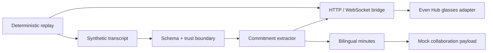

# Ministerial Even Realities PoC

> A multimodal executive-meeting agent that turns a fully synthetic transcript into validated smart-glasses cards, commitment alerts, bilingual minutes, and collaboration payloads—with deterministic replay and failure recovery.

I built the typed event contracts, boundary validators, streaming bridge double, glasses adapter, extraction pipeline, replay harness, and offline regression/evaluation gates. The public scenario and every person, organization, place, commitment, and outcome are fictional.



## Evidence

| Gate | Result |
|---|---:|
| Unit and integration tests | 61 passing |
| Replay commitments | 3/3 |
| Replay false positives | 0 |
| Evaluation tasks | 20 |
| Evaluation trials | 60 |
| Paid credentials needed in CI | 0 |
| npm vulnerabilities | 0 |

## Quickstart

Requires Node.js 22+ and no paid account:

```bash
npm ci
npm test
npm run typecheck
npm run replay:check
npm run eval
```

Run the local bridge and replay in two terminals:

```bash
npm run stub-bridge
npm run replay -- --bridge http://localhost:8787
```

The optional UI uses the publicly distributed Even Hub SDK:

```bash
npm run plugin:dev
```

## What I built

- JSON Schema contracts and strict TypeScript types for every event boundary.
- A reconnecting WebSocket client with deterministic close behavior.
- A local HTTP/WebSocket bridge double for failure and replay testing.
- A schema-validated commitment-to-minutes pipeline with Arabic summary support.
- Recorded-input replay so CI does not need speech, CRM, collaboration, or model credentials.
- Twenty outcome-focused evaluation cases, each run three times.

## Repository map

```text
contracts/  JSON Schemas, types, and boundary validators
fixtures/   Newly written synthetic meeting and expected outcomes
scripts/    Extractor, minutes pipeline, replay/eval gates, bridge double
plugin/     Even Hub adapter and companion UI
```

The bridge interface is documented in [scripts/src/stub-bridge/CONTRACT.md](scripts/src/stub-bridge/CONTRACT.md).

## What is mocked

Speech recognition, model extraction, enterprise CRM, integration middleware, collaboration posting, people, organizations, geography, and meeting content are synthetic or locally mocked. The repository contains no customer seed data or deployment configuration.

## Known limitations

- The extractor is deterministic and intentionally scoped to the recorded fixture.
- Hardware behavior is tested through SDK contracts and a simulator, not claimed as a production deployment.
- Arabic output is a fixture-level workflow assertion, not a language-quality benchmark.
- Real integrations require separate authorization, threat modeling, and end-to-end evaluation.

See [SECURITY.md](SECURITY.md), [PROVENANCE.md](PROVENANCE.md), and [LICENSE](LICENSE).
