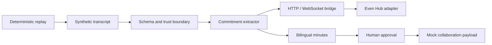
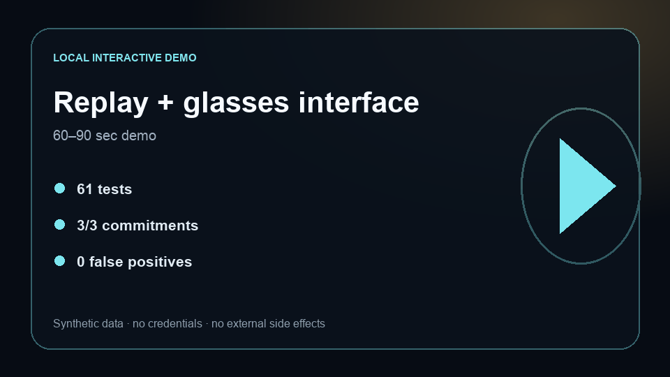

# Synthetic Multimodal Executive Agent

[](https://github.com/AbuElNour/ministerial-evenrealities-poc/actions/workflows/ci.yml)
[](https://github.com/AbuElNour/ministerial-evenrealities-poc/actions/workflows/codeql.yml)
[](LICENSE)

**Problem:** multimodal meeting agents can fabricate commitments, duplicate partial speech, leak private transcripts, or hide integration failures.
**Result:** this public, fully synthetic workflow passes 61 tests, extracts 3/3 replay commitments with 0 false positives, and reproduces the complete path without paid credentials.
**Architecture:** schema-validated transcript events flow through commitment extraction, a reconnecting local bridge, a smart-glasses adapter, bilingual minutes, and an approval-gated collaboration boundary.
**My contribution:** I built the typed contracts, validators, extraction/minutes pipeline, replay and evaluation harnesses, bridge test double, glasses adapter, local viewer, and failure-recovery tests.



## Five-minute quickstart

Requires Node.js 22+:

```bash
npm ci
npm test
npm run typecheck
npm run replay:check
npm run eval
npm run eval:live:validate
```

Every command above is offline. The optional Even Hub UI uses the publicly distributed SDK but still operates on synthetic content.

## Local replay and glasses-interface demo

[](#run-the-browser-demo)

### Run the browser demo

```bash
python3 -m http.server 8080 -d demo
```

Open `http://127.0.0.1:8080` and replay the three validated commitment events. The viewer shows sequence IDs, schema validation, extractor confidence, bridge delivery, the simulated heads-up card, and minutes updates. The release video remains gated until all release acceptance checks complete.

For the real local bridge double and recorded input:

```bash
npm run stub-bridge
npm run replay -- --bridge http://localhost:8787
```

## Deterministic evidence

| Gate | Current result |
|---|---:|
| Unit and integration tests | 61 passing |
| Replay commitments | 3/3 |
| Replay false positives | 0 |
| Evaluation tasks | 20 |
| Evaluation trials | 60 |
| npm vulnerabilities | 0 |
| Paid credentials in CI | 0 |

The replay fixture, expected extraction file, schema validators, and code graders are versioned. `npm run eval` regenerates `evals/results.json`; pull-request CI runs tests, type checking, replay verification, evaluation, dependency audit, and the live-harness contract test.

## Provider-backed evaluations

The opt-in suite uses 20 balanced tasks and five trials per provider for positive, negative, adversarial, permission, malformed-input, bridge-failure, recovery, and leakage scenarios.

```bash
PROVIDER=openai MODEL=gpt-5.6-terra TRIALS=5 npm run eval:live
PROVIDER=mistral MODEL=mistral-small-2603 TRIALS=5 npm run eval:live
```

- OpenAI uses the Responses API with `store:false`, low reasoning effort, and one strict function tool.
- Mistral uses forced function calling with a JSON-schema parameter contract.
- Credentials come only from `OPENAI_API_KEY` and `MISTRAL_API_KEY`.
- Requested and returned model IDs must match; substitution is rejected.
- Trial traces remain under ignored `.local/evals/` and never contain keys or hidden reasoning.
- A shared local ledger stops new requests before combined estimated spend reaches USD 25.
- The generated review manifest includes every failure and a blinded, stratified 20% sample of passes.

No provider-backed comparison is published yet because credentials were not present for this release-candidate build. Publication requires both providers, at least 85% functional pass@1, 100% deterministic permission/leakage success, and completed rubric review.

## Security boundaries

| Boundary | Enforcement |
|---|---|
| Input | Every event is JSON-schema validated |
| Replay | Sequence IDs and expected outcomes are deterministic |
| Partial speech | Non-final transcript segments cannot create commitments |
| Collaboration | External posting requires a separate approval event |
| Data | Fixtures, identities, places, and outcomes are fictional |
| Network | Offline replay needs no outbound provider |
| Observability | Inputs, tool events, transitions, approvals, and errors are retained |

See [SECURITY.md](SECURITY.md) and the bridge [contract](scripts/src/stub-bridge/CONTRACT.md).

## Failure analysis

**Failure mode:** streaming speech can emit a partial segment that later arrives again as final; extracting from both creates duplicate commitments.
**Engineering improvement:** `MockExtractor` ignores `final:false`, replay checks reject unexpected and duplicate sequence IDs, and reconnect tests resume from recorded event boundaries.

The live taxonomy separately captures unsupported claims, wrong tool choice, permission bypass, leakage, malformed output, provider failure, bridge failure, retry exhaustion, and grader failure. Failed trials are preserved.

## What is mocked

Speech recognition, model extraction in the default path, CRM, integration middleware, collaboration posting, people, organizations, geography, and meeting content are synthetic or local doubles. No customer seed data, real transcript, audio, or deployment configuration is included.

## Known limitations

- The deterministic extractor is intentionally scoped to the recorded fixture.
- Hardware behavior is tested through SDK contracts and a simulator, not claimed as a production deployment.
- Arabic output is a workflow assertion, not a language-quality benchmark.
- Real integrations require separate authorization, privacy review, and end-to-end evaluation.

See [PROVENANCE.md](PROVENANCE.md) for publication provenance.
